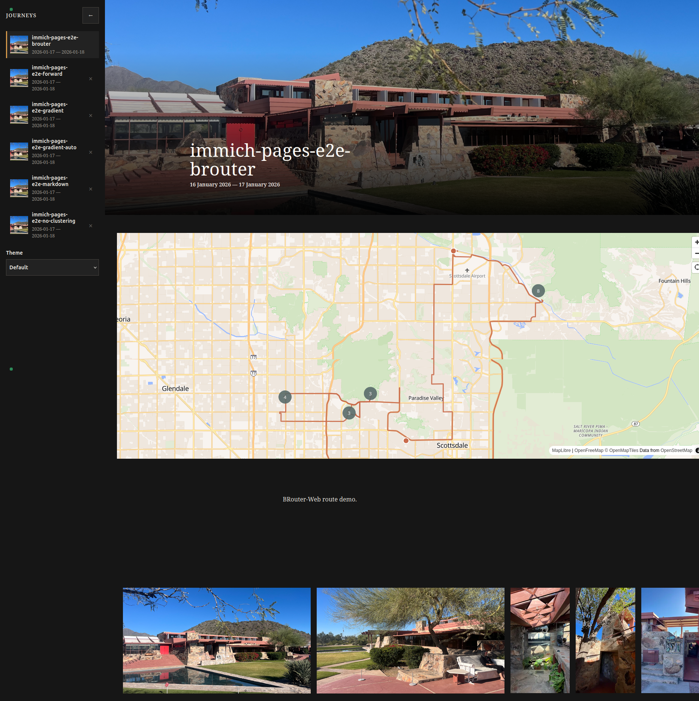

# Immich Pages

Immich Pages is a stateless presentation layer for your shared Immich albums.

This project is born from my desire to share my adventures with family and friends whilst not exposing Immich directly to them, or them to Immich, without the drama of managing users and other things.

Here are the high level features:

* HDR image support as AVIF for clients that support it or clever video tricks for older HDR clients that don't (like iOS < 26).

* Stateless WRT Immich - all Pages needs is the public Immich URL, no API keys or other knowledge of Immich, all auth is passed through via the share key/url.

* Map generation from provided images as
  
  * Clickable points on the map
  
  * Clustering of images
  
  * Auto route calculation and display
  
  * Route from BRouter URL

* Full Markdown and LaTeX rendering support from album description.

* Client side _library_ of shared albums is maintained through browser cookie for easy reference.

* Album look and feel is fully controlled per album via front matter in the Immich album description, with sensible defaults for minimal config.

* Light and dark themes, defaults to system setting.

* Configurable caching, in memory or on disk, of generated HDR artefacts etc.

* Configurable cache pre-warming for HDR content.

* Potential future support for further templates beyond the default 'journey' template...

`

## Ecosystem

This project is part of my personal self-hosted _(i)Cloud independence_ ecosystem as:

1. Self hosted Immich behind Traefik and Authelia 

2. [iCloud photo downloader with Immich support for stacking and favouriting](https://github.com/spmp/icloud_photos_downloader)

3. [iCloud photo downloader web interface](https://github.com/spmp/icloudpd-web)

4. [Immich Pages for sharing albums in a beautiful manner](https://github.com/spmp/immich-pages)

The happy path has been tested here with iPhone photos as the source and should support HDR from other sources as well. Please LMK via issue or PR how things need to change to support your particular upstream image formats.

## Quickstart

To most quickly evaluate this project, clone it and run the following:

```bash
npm run dev:real-immich            # Ctrl-C stops Pages and leaves Immich running
npm run dev:real-immich -- --down  # or: Ctrl-C also stops the Immich containers
```

and browse to one of the test albums, such as http://localhost:8080/share/slug/e2e-brouter - others are listed in the run output. To remove the test Immich entirely, run `docker compose down --volumes` in `tests/e2e/real-immich`.

The example albums and shares can be changed by editing `tests/e2e/real-immich/seed.mjs`; the next `npm run dev:real-immich` applies the changes, no teardown needed.

### Workflow

Once the tech stack is up and running, the process for generating a Pages share is as:

1. Create an Immich album

2. Include Pages share configuration in the beginning of the album description. This requirement can be relaxed by setting `PAGES_ALL_ALBUMS_ARE_PAGES` to `true`

3. Optionally modify the album order, cover image, and description text AFTER the top matter

4. Create a share, either the long form or with a _custom URL_

5. Share this URL with your F&F's

6. Enjoy

### Docker compose

To include this project in your already running Immich stack requires creating a few Traefik route changes and including the Pages service as:

```yml
name: immich

services:
  immich-server:
    container_name: immich_server
    image: ghcr.io/immich-app/immich-server:v3
    labels:
      traefik.enable: true
      traefik.http.routers.immich.rule: "Host(`immich.example.com`)"
      traefik.http.services.immich.loadbalancer.server.port: "2283"
      # Share links go to Pages. Use the same entrypoint/TLS settings as your Immich router.
      traefik.http.routers.immich-share-to-pages.rule: "Host(`immich.example.com`) && (PathPrefix(`/share/`) || PathPrefix(`/s/`))"
      traefik.http.routers.immich-share-to-pages.priority: 100
      traefik.http.routers.immich-share-to-pages.entrypoints: websecure
      traefik.http.routers.immich-share-to-pages.tls: true
      traefik.http.routers.immich-share-to-pages.middlewares: "immich-share-key-redirect,immich-share-slug-redirect"
      traefik.http.routers.immich-share-to-pages.service: "immich"
      traefik.http.middlewares.immich-share-key-redirect.redirectregex.regex: "^https://immich\\.example\\.com/share/(.+)"
      traefik.http.middlewares.immich-share-key-redirect.redirectregex.replacement: "https://pages.example.com/share/key/$${1}"
      traefik.http.middlewares.immich-share-slug-redirect.redirectregex.regex: "^https://immich\\.example\\.com/s/(.+)"
      traefik.http.middlewares.immich-share-slug-redirect.redirectregex.replacement: "https://pages.example.com/share/slug/$${1}"
      # Once you are happy with the mapping, add `redirectregex.permanent: true` to both
      # middlewares; browsers cache a permanent redirect indefinitely.
    ...
  ...
  pages:
    container_name: pages
    image: ghcr.io/spmp/immich-pages:latest
    #build:
    #  context: https://github.com/spmp/immich-pages
    environment:
      IMMICH_BASE_URL: https://immich.example.com
      PAGES_SESSION_SECRET: "your-secret" # generate with `openssl rand -hex 32`
      PAGES_VISITED_SHARES_SECRET: "another-secret" # generate separately with `openssl rand -hex 32`
    depends_on:
      - immich-server
    networks:
      - <your Immich stack network>
    labels:
      traefik.enable: "true"
      traefik.http.routers.pages.rule: "Host(`pages.example.com`)"
      traefik.http.routers.pages.entrypoints: websecure
      traefik.http.routers.pages.tls: true
      traefik.http.services.pages.loadbalancer.server.port: "3000"
    healthcheck:
      test:
        [
          "CMD",
          "node",
          "-e",
          "fetch('http://127.0.0.1:3000/health').then(r => { if (!r.ok) process.exit(1) }).catch(() => process.exit(1))"
        ]
      interval: 2s
      timeout: 3s
      retries: 20
```

See [docker-compose.yml](docker-compose.yml) for a complete stack including Traefik (and [Complete Quick Start With Docker Compose](#complete-quick-start-with-docker-compose) below), [docs/deployment.md](docs/deployment.md) for every server setting, and the section below on configuring an album.

### Pages share configuration

The Pages presentation of your shared Immich album is configured via YAML front matter at the start of the Immich album description, between `---` lines. Please note that the indentation matters! A complete guide is available in [docs/journey-template.md](docs/journey-template.md) and should be consulted as this section is very minimal, covering the most used options.

The minimum required configuration for a page to load is:

```
---
immich-presentation:
---
```

#### Map

The map is the main thing to be configured, and in particular whether to use an auto-generated route, or one from BRouter-web.

1. To use a custom BRouter-web route:
   
   1. Head over to [https://brouter.de/brouter-web](https://brouter.de/brouter-web) , create the route you want
   
   2. Copy the URL
   
   3. Set it as the URL parameter with the map settings as:

```
---
immich-presentation:
  map:
    source: brouter-web
    url: "https://brouter.de/brouter-web/#map=..."
---
```

2. Map can be disabled as:

```
---
immich-presentation:
  map:
    enabled: false
---
```

3. Image clustering can be disabled as:

```
---
immich-presentation:
  map:
    clustering: false
---
```

#### Background gradient

The background defaults to the theme colour for light and dark. This can be overridden by an automatic gradient sampled from the album's hero image, or set manually. For example the automatic gradient is set as:

```
---
immich-presentation:
  gradient:
    auto: true
---
```

## HDR

Having an HDR view on my Immich media is a must given the HDR capability of the source images and the ubiquity of HDR capability in smartphones and many displays.

At the time of writing this is a major gap in the Immich iOS and web apps. This gap also exists in desktop versions of Firefox. Please check the HDR capability of your display and browser at the [Wide Gamut test page](https://www.wide-gamut.com/) 

HDR content is delivered depending on the detected capabilities as:

1. **SDR**: SDR display or browser with no HDR capabilities

2. **BT.2020 HDR Video**: HDR display and browser with no HDR AVIF (gainmap) support. A trick I saw in the Wide Gamut page was that a single frame video could display HDR when the browser was generally not capable. For example WebKit < v26

3. **HDR AVIF (gainmap):** HDR display and browser capable of HDR AVIF with gainmap. This includes desktop Chromium and WebKit ≥ v26. AVIF has the advantage of being higher quality and lower size than JPG, who knew!

This project has been exclusively tested with Apple Photos generated HEIC files as source and includes custom binaries which convert the HEIC into either single frame video or AVIF with the correct gainmap. At the time of writing there was no existing tool that does this.

Please see [docs/hdr-media.md](docs/hdr-media.md) for a complete discussion.

## Share URL and proxy contract

The supported public grammar is exactly:

```text
https://pages.example.xyz/share/key/<opaque-ref>
https://pages.example.xyz/share/slug/<opaque-ref>
```

`key` and `slug` are explicit route kinds; Pages never guesses between them.
Traefik redirects `/share/` and short `/s/` links received on
`immich.example.xyz` to the Pages host. Viewers remain on Pages: upstream URLs, login pages, media URLs,
cookies, and response details are never relayed. Only the visitor's
incoming `Cookie` and `Authorization` reach the configured `IMMICH_BASE_URL`;
Pages never synthesizes an owner/API key credential.

Password handoff is delegated to Immich and stored only as a bounded,
host-scoped encrypted Pages session. Every page and media request revalidates
the share. A valid ordinary album share is a branded non-page result, not an
Immich redirect; ordinary Immich root paths remain outside the Pages router.

## Complete Quick Start With Docker Compose

[`docker-compose.yml`](docker-compose.yml) is a complete, minimal stack: Traefik
(with Let's Encrypt certificates), Immich, and Pages, including the Immich share
redirect. Use it for a fresh server; to add Pages to an existing Immich, use the
snippet above or [`compose.yaml`](compose.yaml) instead.

1. Clone this repository, or copy `docker-compose.yml` and `.env.example` into a
   directory.
2. Create the environment file:

```sh
cp .env.example .env
```

3. Edit `.env` and set `IMMICH_HOST`, `PAGES_HOST`, `LETSENCRYPT_EMAIL`,
   `DB_PASSWORD`, `PAGES_SESSION_SECRET` and `PAGES_VISITED_SHARES_SECRET`.
   Both hostnames must resolve to this server, and ports 80 and 443 must reach it.
4. Start the stack:

```sh
docker compose -f docker-compose.yml up -d
docker compose -f docker-compose.yml ps
```

The `-f` matters: with both files present, a plain `docker compose` picks
`compose.yaml` (Pages alone).

Open `https://<pages-host>/share/key/<share-key>` for a Pages presentation. An
Immich share link, `https://<immich-host>/share/<share-key>` or the short
`https://<immich-host>/s/<slug>`, is redirected to Pages, including its query
string. Normal Immich URLs remain on Immich. See
[`docs/deployment.md`](docs/deployment.md) for every setting, TLS,
reverse-proxy, recovery, and security details.

## Development and testing

```sh
npm ci
npm run check
npm run test
npm run build
```

`npm run dev:real-immich` (see [Quickstart](#quickstart)) runs Pages against a
real, disposable Immich with seeded demo albums, HDR and maps working; its log is
in `.cache/pages-dev.log`. See
[`tests/e2e/real-immich/README.md`](tests/e2e/real-immich/README.md) for the
seeded albums and known findings.

Browser tests use Playwright:

```sh
npx playwright install --with-deps chromium
npm run test:e2e:mock         # most specs, against a fast mock Immich
npm run test:e2e:real-immich  # specs that must decode real photos, against a real Immich
npm run test:e2e              # the Traefik topology: Pages + mock Immich + Traefik
```

The mock (`tests/e2e/mock-immich-server.mjs`) fabricates asset bytes: enough to
exercise routing, caching, and control-plane logic, but not real image decoding,
which is what the real-Immich run is for. `npm run test:e2e` starts a disposable
Pages/mock-Immich/Traefik topology on `pages.example.xyz:18080` and tears it down
afterwards; it fails rather than switching browsers if Chromium is absent. An
optional live check against your own deployment and a disposable share:

```sh
PLAYWRIGHT_BASE_URL=https://pages.example.xyz npm run e2e -- tests/e2e/direct-share.spec.ts
```

### Building the image outside an isolated dev container

When development happens in an isolated container that cannot run your Docker
builds (for example a coding-agent sandbox), `scripts/watch-compose-rebuild.sh`
bridges the two. Run it on the Docker host, watching a directory the container
can write to:

```sh
scripts/watch-compose-rebuild.sh \
  --compose-file /path/to/production/docker-compose.yml \
  --service pages \
  --watch-dir /path/to/sources/immich-pages/rebuild
```

Then, inside the container, `touch rebuild/rebuild` rebuilds and recreates only
the Pages service; `rebuild/status` reports `building`, `starting`, `ready` or
`failed`. The `rebuild/` directory is ignored by git. See
[`docs/deployment.md`](docs/deployment.md#external-build-watcher) for every option.

## Licence
Code: Copyright (C) 2026 Jasper Aorangi. Licensed under AGPL-3.0-only
Photos: © 2026 Jasper Aorangi. Licensed CC BY-NC 4.0.

